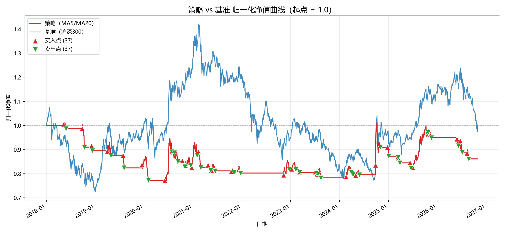

一个**精简量化回测系统**。基于沪深300ETF（510300）日线数据，用 MA5/MA20 金叉死叉生成交易信号，自行实现回测内核，并与沪深300指数（000300）买入持有基准做横向对比。

本系统**只保留三个借鉴自 backtrader 的设计点**，其余 backtrader 特性（订单类型、佣金滑点、多数据源、元类、观察者、analyzer 体系等）一概不引入：

1. **T+1 开盘成交** —— T 日信号暂存为 pending，T+1 日以开盘价撮合，杜绝未来函数
2. **20 日预热期** —— 对齐 MA20 最小周期，预热期内不交易（backtrader 的 minperiod/prenext 思想）
3. **可插拔指标字典输出** —— 指标函数以注册表形式插拔，结果以 dict 返回（借鉴 analyzer 架构）

---

## 一、项目结构

```
.
├── data_loader.py      # 数据层：akshare 拉取日线，统一字段，缓存为 CSV
├── strategy.py         # 策略层：MA5/MA20 计算与金叉死叉信号生成
├── backtest.py         # 回测层：逐日撮合内核 + 可插拔绩效指标
├── report.py           # 展示层：净值曲线绘制 + 指标表输出 + 样本内外分段
├── requirements.txt    # 依赖清单
├── data/               # 数据缓存（自动下载生成）
│   ├── 510300.csv      # 沪深300ETF 日线
│   └── 000300.csv      # 沪深300指数 日线
└── output/             # 回测输出（自动生成的最终交付物）
    ├── nav_curve.png       # 归一化净值曲线（策略 vs 基准，含买卖点标注）
    ├── metrics.csv         # 全样本指标表
    └── metrics_segments.csv# 样本内/样本外分段指标表
```

分层清晰：数据层 → 策略层 → 回测层 → 展示层，符合作业"模块化架构"要求。

---

## 二、环境配置

依赖已列在 `requirements.txt`：

```bash
pip install -r requirements.txt
```

依赖版本（本次实际验证通过）：pandas 3.1.1 / numpy 2.5.5 / matplotlib 3.11.2 / akshare 1.20.65。

> **Python 3.13 用户注意**：本机 `python` 与 `pip` 可能指向不同环境。若 `python -c "import akshare"` 报模块缺失，请用 `pip -V` 查到 pip 所属环境的解释器来运行，例如：
> ```bash
> /c/Users/Chees/.workbuddy/binaries/python/envs/default/Scripts/python report.py
> ```
> 换成你自己的环境时，直接 `python report.py` 即可。

akshare 接口更新频繁，代码已做版本兼容：指数接口在新版为 `index_zh_hist_em`、旧版为 `index_zh_a_hist`，自动探测；东方财富源偶发限流时自动降级到新浪源。

---

## 三、运行方式

### 一键运行（推荐）

```bash
python report.py
```

会依次输出：全样本、样本内、样本外三张指标表，打印成交笔数一致性校验，并在 `output/` 下生成净值图和两份指标表。

### 分步调用

```python
from data_loader import load_all
from strategy import generate_signals
from backtest import run_backtest

etf, bench = load_all()              # 拉取/读取缓存数据
signals = generate_signals(etf)      # 生成每日信号（1 买入 / -1 卖出 / 0 持有）
result = run_backtest(etf, signals)  # 回测
print(result["metrics"])             # 指标字典（可插拔）
print(result["trades"])              # 成交记录列表
```

### 单独运行各模块

- `python data_loader.py` —— 只下载数据到 `data/`
- `python strategy.py` —— 查看信号统计
- `python backtest.py` —— 单独跑回测并打印指标

---

## 四、策略逻辑

**指标公式**（`strategy.py` 中各自封装为独立函数，注释含计算方式）：

- `MA5[t] = (close[t-4] + ... + close[t]) / 5`，前 4 日 NaN
- `MA20[t] = (close[t-19] + ... + close[t]) / 20`，前 19 日 NaN

**信号规则**：

| 动作 | 条件 |
|---|---|
| 买入（signal = 1） | MA5 上穿 MA20（昨 MA5 ≤ 昨 MA20 且今 MA5 > 今 MA20）**且** 今 MA20 > 昨 MA20（趋势过滤） |
| 卖出（signal = -1） | MA5 下穿 MA20（昨 MA5 ≥ 昨 MA20 且今 MA5 < 今 MA20） |
| 持有（signal = 0） | 其余情况 |

全仓/空仓二态，不取整手、不计佣金滑点。信号只用历史数据（shift 取昨日值），无未来函数。

---

## 五、回测内核设计

`run_backtest(df, signals, init_cash=1e6, warmup=WARMUP)` 逐日循环分三阶段：

- **阶段 A（撮合）**：用**今日开盘价**成交昨日 pending 信号 —— T+1 核心
- **阶段 B（记信号）**：读取今日信号，记为 pending 供明日成交
- **阶段 C（估值）**：按今日收盘价计算净值

返回 `{"nav": Series, "trades": list[dict], "metrics": dict}`。

**分段回测的一致性**（重要）：信号只在全样本上计算一次，分段时按日期切片传入；样本外用 `warmup=0`，因为段首 MA20 已含 2022 年历史，若重新预热会二次吃掉段初真实交易。这样保证 `全样本成交笔数 = 样本内 + 样本外`，程序内已加校验输出。

**可插拔指标**：`METRIC_REGISTRY` 注册表 + `@register_metric("名字")` 装饰器。新增指标只需写一个 `func(nav, trades, df) -> float` 并加装饰器，无需改内核。已内置累计收益率、年化收益率、最大回撤、夏普比率四项。

---

## 六、数据来源与区间

- **数据源**：akshare 免费接口（东方财富 / 新浪）
- **标的**：510300（沪深300ETF，策略交易标的）、000300（沪深300指数，基准）
- **区间**：2018-01-01 ~ 2026-10-31，共 2140 个交易日（最后交易日 2026-10-30）
- **样本内**：2018-01-01 ~ 2022-12-31；**样本外**：2023-01-01 ~ 2026-10-31
- **基准选择理由**：沪深300指数是 A 股核心宽基指数，与策略交易的沪深300ETF 标的完全一致，能公允衡量"择时相对买入持有的增益"，是自然且可解释的基准。

---

## 七、输出结果

运行 `report.py` 后 `output/` 下生成：

- `net-value.jpg`：策略与基准归一化净值曲线（均从 1.0 起），红三角为买点、绿三角为卖点
- `metrics.csv`：全样本四项指标对比
- `metrics_segments.csv`：样本内/样本外分段指标对比
- 
